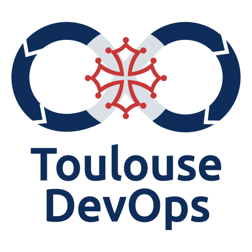

# Toulouse DevOps – brand assets

Logo, colours, typography and print material for **Toulouse DevOps**, the
DevOps community of Toulouse.

> « La communauté DevOps de Toulouse — Meetups, talks et partage de bonnes pratiques »

The reference online version of these guidelines is
<https://toulouse-devops.org/brand/>. Usage rules are detailed in
[GUIDELINES.md](GUIDELINES.md).



## Contents

| Path | What | Use it for |
|------|------|------------|
| `logo/toulouse-devops-logo.svg` | Full logo, vector, text outlined, transparent background | Print, large formats, anything vector |
| `logo/toulouse-devops-logo.pdf` | Same, as PDF | Print shops, office tools |
| `logo/png/toulouse-devops-logo-{256,512,1024,2048}px.png` | Full logo, transparent background | Web, social networks, slides |
| `logo/png/toulouse-devops-logo-*-white.png` | Full logo on a white background | Tools that do not handle transparency |
| `logo/toulouse-devops-mark.svg`, `logo/png/toulouse-devops-mark-*.png` | Symbol only (infinity loop + Occitan cross) | Avatars, favicons, stickers, when the name is already written nearby |
| `logo/source/` | Original Inkscape file and the PNG published on the website | Editing the master artwork |
| `colors/` | Palette as JSON, CSS custom properties, SCSS variables, GIMP/Inkscape `.gpl` | Design tools and code |
| `kakemono/` | Roll-up banner 85 × 200 cm (SVG, print-ready PDF, preview PNG) | Events, conferences, sponsor booths |
| `tools/` | Python scripts that generate every file above | Regenerating / updating the assets |

## Colours

| Name | Hex | Usage |
|------|-----|-------|
| Bleu principal | `#0e2d5a` | Titles, main elements, footer |
| Rouge accent | `#c83737` | CTAs, badges, attention elements |
| Bleu clair | `#1a4a8a` | Hover, links, secondary accents |
| Bleu pâle | `#e8eef5` | Section backgrounds, cards |
| Rouge clair | `#e85555` | CTA hover |
| Rouge pâle | `#fdf2f2` | Alerts, notifications |
| Gris texte | `#374151` | Body text |
| Gris clair | `#6b7280` | Secondary text, captions |
| Fond de page | `#fafbfc` | Page background |
| Surface | `#ffffff` | Cards, containers |
| Bordure | `#e5e7eb` | Borders, separators |

## Typography

All fonts are free and available on Google Fonts.

| Font | Weights | Usage |
|------|---------|-------|
| [Ubuntu](https://fonts.google.com/specimen/Ubuntu) | Medium (logo), Bold | Logo and headings |
| [Inter](https://fonts.google.com/specimen/Inter) | Regular, SemiBold | Body text |
| [JetBrains Mono](https://fonts.google.com/specimen/JetBrains+Mono) | Regular | Code |

## Kakemono (roll-up banner)

`kakemono/toulouse-devops-kakemono-85x200.pdf` is the file to send to the
printer.

- Final size **850 × 2000 mm**, 1 SVG unit = 1 mm, no crop marks.
- Fully vector, all text converted to outlines: no fonts needed to open or
  print it.
- Backgrounds run to the edges. If the printer asks for bleed, extend the
  white top and navy bottom by the requested amount (no content sits closer
  than 70 mm to the sides).
- The top ~45 mm (clamp bar) and the bottom ~80 mm (base cassette) carry no
  content.
- No transparency: the semi-transparent disc of the logo is flattened to
  solid colours (identical result on the white background).
- The QR code sits roughly 95–125 cm above the floor, easy to scan standing.
- Colours are RGB (sRGB); let the print shop convert to CMYK with their
  profile, and ask for a proof if colour accuracy matters.
- The QR code points to <https://toulouse-devops.org/>.

Texts, topics and figures live at the top of `tools/build_kakemono.py`;
update them there and rebuild rather than editing the SVG by hand.

## Rebuilding the assets

Requirements: Python 3, `rsvg-convert` (librsvg, `brew install librsvg`), and
the Ubuntu and Inter fonts installed locally (or a `FONTS_DIR` environment
variable pointing to a directory that contains `Ubuntu-Medium.ttf`,
`Ubuntu-Bold.ttf` and `Inter-VariableFont_opsz,wght.ttf`).

```sh
make venv   # creates .venv with fonttools, uharfbuzz and segno
make        # regenerates logo, palette and kakemono
```

The logo geometry (`tools/brand.py`) is taken verbatim from the Inkscape
master in `logo/source/`; the wordmark is re-typeset in Ubuntu Medium with
the exact size, position and stroke of the master, then outlined.
